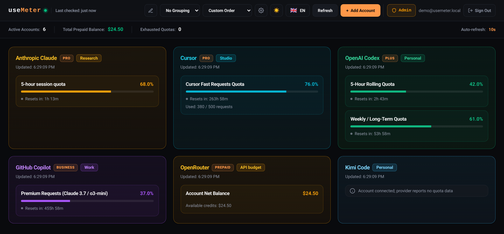

# useMeter - Self-hosted AI usage and quota tracking

useMeter brings supported AI provider usage, quota windows, balances, and reset times into one self-hosted dashboard. It stores account data in a local SQLite database and refreshes provider reports in the background.

> **Dashboard preview:** This screenshot uses synthetic demo accounts and usage values; it does not show real credentials or a live account.
> 

## What it does

- Brings provider-reported usage windows, balances, credits, and reset times into one dashboard.
- Keeps a history of usage snapshots and displays stale/error states rather than treating a failed refresh as a current reading.
- Supports multiple accounts and labels, dashboard organization and appearance preferences, and English/Turkish UI text.
- Supports multiple users with separate accounts and usage data; the first account becomes the administrator, who can invite other users.

Usage is limited to what each provider exposes and what the configured credential can access. Quota values, refresh intervals, available windows, and authorization behavior are provider-dependent; useMeter is not an authoritative billing record.

## Provider support and verification

The adapters below are implemented in the repository. That means useMeter contains integration code for the listed authentication/data paths. Not that every provider, account tier, region, or OAuth flow has been independently verified for your deployment. Availability and returned fields can change upstream.

| Provider | Implemented connection and reported data | Important limitations / verification status |
| --- | --- | --- |
| OpenAI Codex | Device authorization or a manually supplied token; reports usage windows when available. | Provider/account eligibility and live results depend on the credential. |
| Anthropic Claude | OAuth with a pasted registered callback URL (or `code#state`), or a manually supplied token/API key; reports Claude Code usage windows. | The hosted flow does not listen on the server's localhost. Report availability still depends on the credential and upstream account data. |
| GitHub Copilot | Device authorization or manually supplied token; reports Copilot quota/seat data. | Copilot plan and seat eligibility are determined by GitHub. |
| Cursor | Browser OAuth flow or manual session token; reports usage and request limits. | Session credentials and exposed limit data are controlled by Cursor. |
| Google Antigravity | OAuth or manually supplied access token; parses quota-window summaries. | Hosted production login defaults to the embedded desktop client and a one-time full loopback callback URL paste; an operator-owned Web client can instead use the public HTTPS callback. Account/API compatibility must still be verified with that deployment. |
| Google Gemini CLI | OAuth with a pasted full callback URL, or a manually supplied access token; reports the quota data available to its integration. | Separate from Antigravity. The embedded client's registered loopback URI is retained; account/API compatibility is not implied by the adapter. |
| OpenRouter | Headless S256 PKCE: paste the one-time code shown by OpenRouter, or use an API key; reports balance and credit/usage data. | No callback URL or server localhost listener is used. Values reflect the provider API response at polling time. |
| DeepSeek | API key; reports balance data. | Depends on the API account and the fields returned by the provider. |
| xAI | Device OAuth or manually supplied token; reports available usage/balance data. | Provider account eligibility and live responses are not guaranteed by adapter presence. |
| Zhipu AI (GLM) | OAuth with a pasted full registered callback URL, or a manually supplied API credential; reports available quota data. | The hosted flow does not rely on a server localhost listener; availability depends on the account and API response. |
| MiniMax Code | Manually supplied API credential; reports plan quota data. | Plan fields and reset details depend on the provider response. |
| Cline Pass | Manually supplied API key; reports percentage-based five-hour, weekly, and monthly usage windows with reset data. | Does not report balance or credit data. |
| Devin | Manual CLI session token; an OAuth callback path is also present. | Hosted OAuth redirect compatibility is experimental and unconfirmed. `cog_` V3 personal access tokens are not supported by this adapter. |
| Umans | Manually supplied API key; reports available usage/plan data. | Depends on the API account and returned fields. |
| Kimi Code | Kimi OAuth credential; parses recognized coding usage windows. | HTTP 200 with `{}` is treated as a valid connected/no-quota-data response. It does not establish an account's membership, tier, or region; no quota percentage is invented. Standard API keys are not accepted for this usage endpoint. |
| OpenCode Go | Manually supplied API key; reports available plan/quota data. | Depends on the provider account and response. |
| Alibaba Qwen | API key or supported console-cookie credential; reports available token-plan data. | Plan and expiry fields depend on the provider response. |

The project contains provider adapters and local tests; real-world compatibility must be evaluated with the intended provider account and deployment. In particular, a successful OAuth exchange alone does not guarantee the provider will return quota data.

## Run locally

### Prerequisites

- [Bun](https://bun.sh/) and Git.
- OpenSSL for generating a random master key. The container image is based on Bun 1.4.0; that image pin is not a statement of the minimum supported Bun version.

### Install, build, and start

Build the browser client before starting the server: the server serves the generated files from `dist/client/`.

```sh
git clone https://github.com/muwat0/useMeter.git
cd useMeter
bun install
bun run build

# Run key setup, loading, validation, and startup in a subshell so any failure
# stops this snippet without leaving shell state behind.
(
  set -eu
  key_file="$HOME/.config/usemeter/local.env"
  install -d -m 700 "$HOME/.config/usemeter"
  if [ ! -e "$key_file" ]; then
    key=$(openssl rand -hex 32)
    [ -n "$key" ]
    (umask 077; set -C; printf 'export USAGE_MASTER_KEY=%s\n' "$key" > "$key_file")
  fi
  unset USAGE_MASTER_KEY
  . "$key_file"
  [ -n "${USAGE_MASTER_KEY:-}" ] || { printf 'USAGE_MASTER_KEY is missing or empty\n' >&2; exit 1; }
  export USAGE_MASTER_KEY
  bun run start
)
```

Generating or overwriting the master key after saving credentials makes existing stored secrets unreadable. Always reuse the same key for later runs and keep it backed up securely. The server uses `data/usage.db` by default and listens on port `3100` unless configured otherwise.

Open <http://localhost:3100/register> to create the first account; it is automatically assigned the administrator role. Public registration remains enabled by default. Sign in at <http://localhost:3100/login>, then use the Admin controls to disable public registration before exposing the service to other users. Use a password of at least 12 characters. Sign in at <http://localhost:3100/login> on subsequent visits.

## Docker Compose

Compose builds the client into the image, runs the service as a non-root user, and stores SQLite data in the named `usemeter-data` volume at `/app/data/usage.db`.

Generate a persistent key file outside the checkout on initial setup (an existing file is reused), then start the service:

```sh
(
  set -eu
  env_file="$HOME/.config/usemeter/compose.env"
  install -d -m 700 "$HOME/.config/usemeter"
  if [ ! -e "$env_file" ]; then
    key=$(openssl rand -hex 32)
    [ -n "$key" ]
    (umask 077; set -C; printf 'USAGE_MASTER_KEY=%s\n' "$key" > "$env_file")
  fi
  [ -s "$env_file" ] || { printf 'Compose key file is missing or empty: %s\n' "$env_file" >&2; exit 1; }
  unset USAGE_MASTER_KEY
  docker compose --env-file "$env_file" up -d --build
)
```

Compose normally gives an inherited shell variable precedence over the value in `--env-file`. The startup subshell above clears `USAGE_MASTER_KEY` before invoking Compose so the persisted key file supplies the value. Every later Compose command must use the same file, confirm it is nonempty, and clear any inherited variable in a subshell; for example:

```sh
(
  set -eu
  env_file="$HOME/.config/usemeter/compose.env"
  [ -s "$env_file" ] || { printf 'Compose key file is missing or empty: %s\n' "$env_file" >&2; exit 1; }
  unset USAGE_MASTER_KEY
  docker compose --env-file "$env_file" up -d
)
```

Do not regenerate or overwrite this key: doing so makes stored credentials unreadable.

The default host binding is `127.0.0.1:3100`; this keeps the port off public interfaces and is suitable when a local reverse proxy forwards to it. The host port and bind address can be changed with `USEMETER_PORT` and `USEMETER_BIND_ADDRESS`; do not bind publicly unless you intentionally provide TLS, network access controls, and a trusted deployment perimeter. Preserve the named volume when recreating containers. `docker compose down -v` removes the volume and its database.

For a public deployment, terminate HTTPS at a trusted reverse proxy and keep the application port private. Set `TRUST_PROXY=true` only when the service can only be reached through that trusted proxy and forwarded headers cannot be forged by direct clients. See the [Docker deployment guide](docs/DEPLOYMENT.md) for proxy and data-migration details.

## Configuration and security

| Variable | Purpose and default |
| --- | --- |
| `USAGE_MASTER_KEY` | Required in production; do not use the development fallback. Derives the encryption key for stored credential secrets. Use a long random value, keep it stable, and keep backups protected. |
| `NODE_ENV` | Runtime mode. Compose sets `production`; production mode rejects a missing or development-default master key. |
| `PORT` | HTTP listener port; defaults to `3100`. Compose uses container port `3100`. |
| `DATABASE_PATH` | SQLite database path; defaults to `data/usage.db` locally and `/app/data/usage.db` in Compose. Persist the containing directory/volume. |
| `USEMETER_BIND_ADDRESS` | Compose host-side bind address; defaults to `127.0.0.1`. This controls the published host port, not the container listener. |
| `USEMETER_PORT` | Compose host-side port; defaults to `3100`. |
| `TRUST_PROXY` | Defaults to `false`. Enable only behind a trusted proxy that protects forwarded headers. |
| `CORS_ALLOWED_ORIGINS` | Optional comma-separated origins permitted for cross-origin mutation requests; empty by default. |
| `GOOGLE_OAUTH_CLIENT_ID`, `GOOGLE_OAUTH_CLIENT_SECRET`, `GOOGLE_OAUTH_REDIRECT_URI` | Optional Google OAuth configuration. With no client credentials, hosted production uses the embedded desktop client and manual loopback callback paste; a public redirect URI by itself does not block this fallback. To use automatic public callbacks, configure an operator-owned Google Cloud OAuth Web client and its exact `https://<your-domain>/api/oauth/google/callback` URI. A client ID and secret must be configured together. |
| `DEVIN_OAUTH_REDIRECT_URI` | Optional Devin OAuth redirect configuration; hosted redirect compatibility remains experimental. |
| `ZAI_OAUTH_CLIENT_ID`, `ZAI_OAUTH_CLIENT_SECRET` | Optional Zhipu AI OAuth client configuration. |
| `KIMI_CODE_BASE_URL` | Optional Kimi Code usage API base URL override; the adapter otherwise uses its built-in provider endpoint. |
| `CREDENTIAL_METADATA_ENCRYPTION` | Compose enables metadata-envelope encryption by default. Once a database has migrated to schema version 2, disabling it is not a supported downgrade; read the deployment guide before changing this setting or migrating an existing database. |

Credential secrets are encrypted at rest using AES-256-GCM with a key derived from `USAGE_MASTER_KEY`; passwords use Argon2id, and session tokens are stored as hashes. Metadata encryption has a separate versioned migration setting, so do not interpret the secret-encryption statement as a blanket guarantee that every historical database field or backup is encrypted. Keep database files, backups, the master key, and environment files protected. Do not commit credentials, OAuth client secrets, or populated `.env` files.

## Development commands

| Command | Purpose |
| --- | --- |
| `bun install` | Install dependencies from the lockfile. |
| `bun run build` | Build the browser client into `dist/client/`. |
| `bun run start` | Start the service with `src/index.ts`. |
| `bun run dev` | Start the server in Bun watch mode. |
| `bun run dev:client` | Rebuild the client when frontend files change. |
| `bun x tsc --noEmit` | Check TypeScript types across client and server. |
| `bun test` | Run the test suite. |
| `(unset USAGE_MASTER_KEY && docker compose --env-file "$HOME/.config/usemeter/compose.env" up -d --build)` | Build and start the Compose service. |
| `(unset USAGE_MASTER_KEY && docker compose --env-file "$HOME/.config/usemeter/compose.env" logs -f usemeter)` | Follow service logs. |
| `(unset USAGE_MASTER_KEY && docker compose --env-file "$HOME/.config/usemeter/compose.env" down)` | Stop and remove the Compose service/container without deleting the named data volume. |

CI uses Bun 1.4.0, matching the container runtime. Validate networking regressions on that pinned version as well as your local runtime. HTTP-disconnect tests close the actual request/socket and wait for server and upstream abort events; a rejected `fetch` promise alone does not prove that the connection closed.

The health endpoint is `/health`. The application is a Bun server and must run as a service; it cannot be deployed as static files alone.

## Further reading

- [Technical specification](docs/SPEC.md)
- [Docker deployment guide](docs/DEPLOYMENT.md)
- [ADR-0001: Self-hosted BFF architecture](docs/adr/0001-self-hosted-bff-architecture.md)
- [ADR-0002: Dual-engine tracking model](docs/adr/0002-dual-engine-tracking-model.md)
- [ADR-0003: Multi-tenant session authentication](docs/adr/0003-multi-tenant-session-authentication.md)
- [ADR-0004: Security perimeter and invitation onboarding](docs/adr/0004-security-perimeter-and-invitation-onboarding.md)
- [ADR-0005: Non-destructive stale usage state](docs/adr/0005-nondestructive-stale-usage-state.md)
